# 🛡️ Job Scam Checker

Students get fake internship and job offers that ask for fees, documents or bank details. Paste an offer message (or upload the offer letter as a PDF) and get a risk verdict with evidence and advice **before** you reply or pay.

**Live demo:** [https://jobscamchecker.duckdns.org.](https://jobscamchecker.duckdns.org.)

*Hosted on AWS EC2 with Docker, served over HTTPS (Caddy and Let's Encrypt). Please don't paste real personal details. If the link is down, run it locally using the steps below.*

**Headline result:** on a locked set of 42 unseen real messages (written down before testing), the tool caught **15 of 21 scams with 0 false alarms**. Small sample, so treat it as indicative. Details in [RESULTS.md](RESULTS.md).

## How it works

```
Message / PDF
   │
   ├─► Input shielding: sanitise hidden characters, detect prompt injection
   │
   ├─► Deterministic checks (no LLM)
   │     sender email · WHOIS domain age (cached) · website check · scam phrases ·
   │     sensitive-data requests · payment patterns · lookalike domains
   │
   ├─► LangChain chain 1: structured extraction
   │     (claimed company, asks for money, asks for documents)
   │
   ├─► Rule-based risk score (0-100)
   │
   ├─► LangChain chain 2: LLM second opinion (only if score < 30)
   │
   └─► LangChain chain 3: report writer → validated Pydantic report
         + follow-up chat chain (with conversation history)
```

Design choices:
- **Rules decide the score.** Results are consistent, cheap and explainable.
- **The LLM adds language understanding**, catching polished scams that phrase rules miss. It can only add points, never lower a rule score.
- **Corroboration rules** stop the LLM alone from flagging weak signals (for example, a document request only counts when another warning sign exists).
- **Every LLM call has retries and a fallback model**, so the app does not crash on an API error.
- **A fixed workflow, not an agent.** The checks are known in advance, so a fixed order is cheaper and more reproducible.

## Features
- Paste text or upload a PDF offer letter
- Optional sender email field
- Colour-coded verdict, risk score and evidence with severity badges
- Follow-up chat ("Why is this suspicious?")
- Feedback buttons (👍 / 👎) that can feed future test sets
- Anonymous usage counts (no IP, no message text)
- Scam-reporting guidance (cybercrime.gov.in, 1930 helpline)

## Screenshots

### Scam detected
<p>
  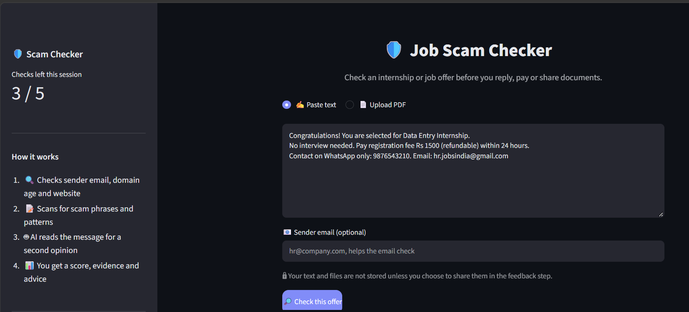
  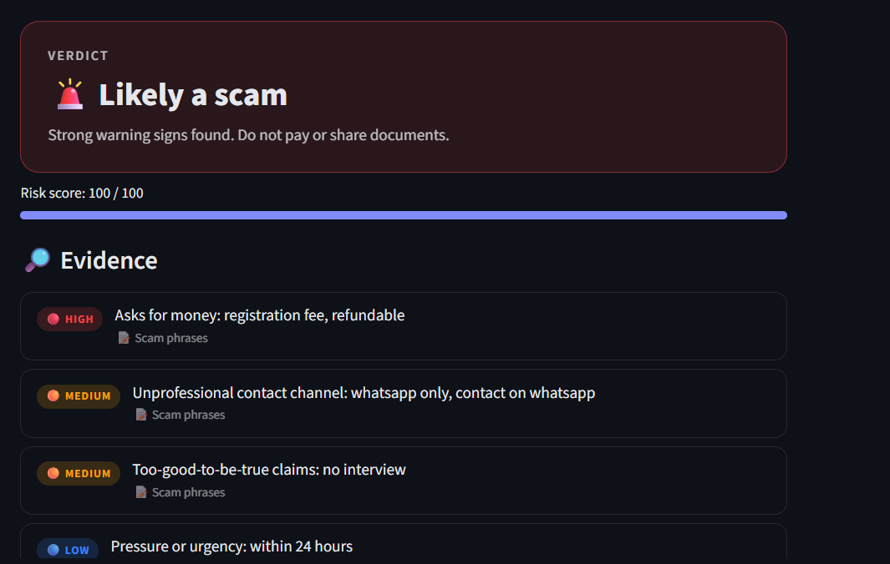
</p>

### Suspicious (AI review used)
<p>
  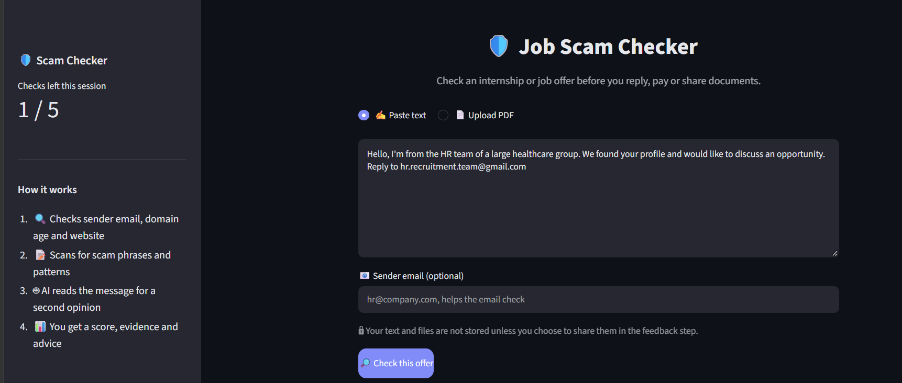
  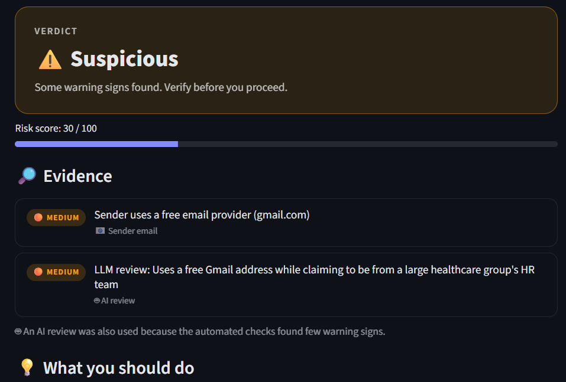
  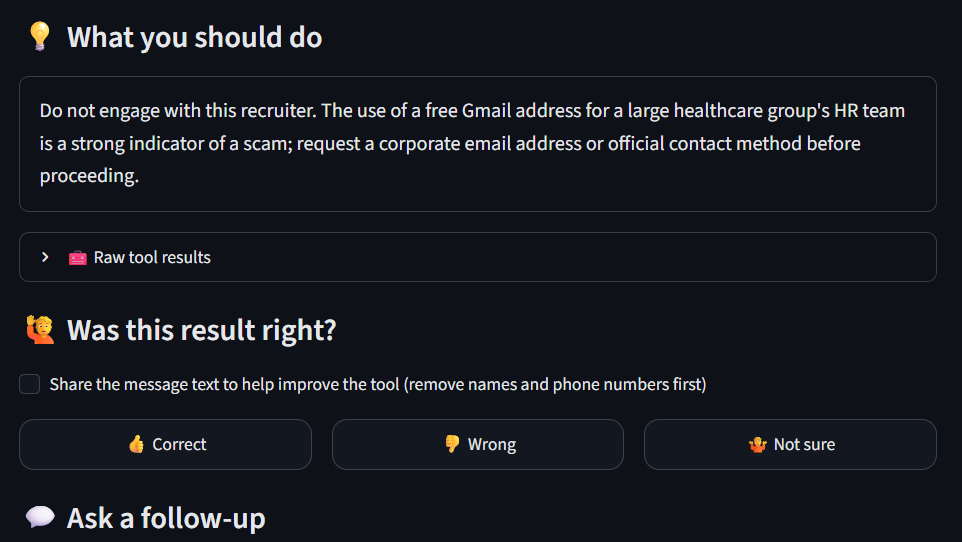
</p>

### Genuine offers
<p>
  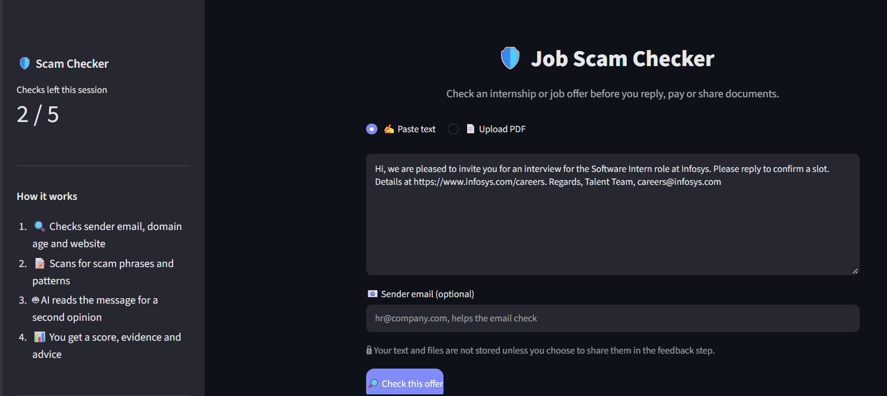
  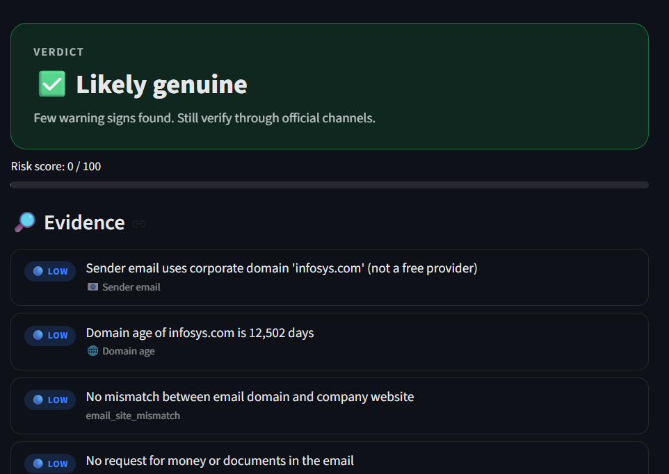
  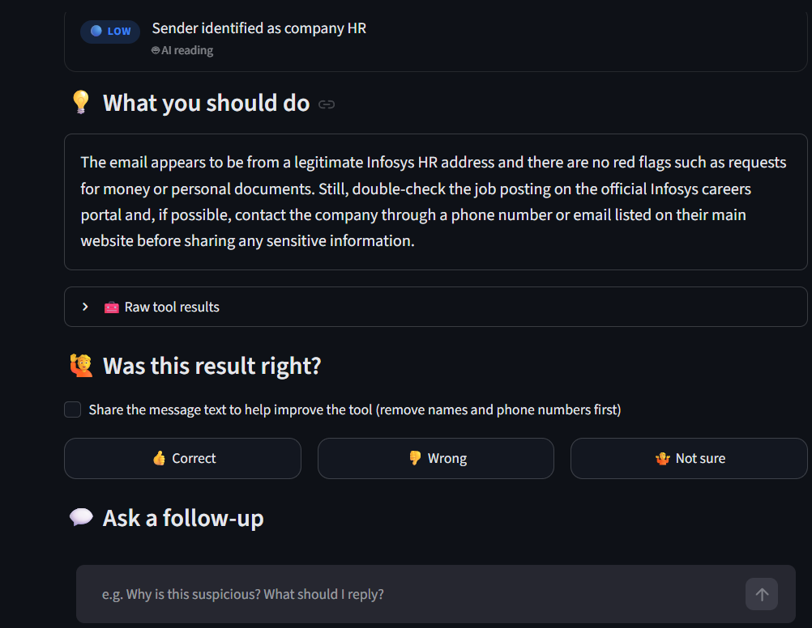
  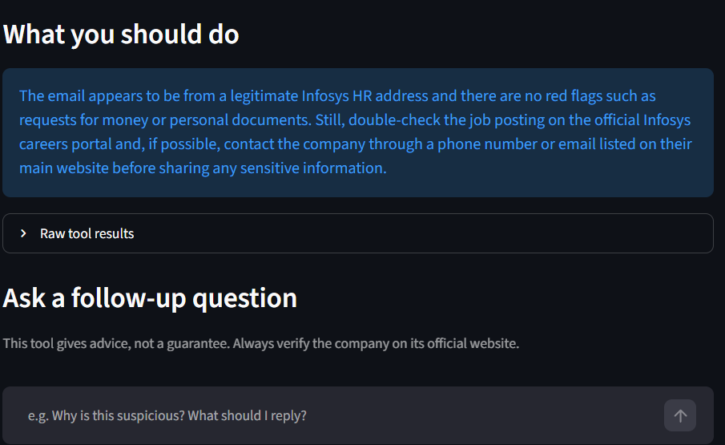
</p>

### PDF offer-letter check
<p>
  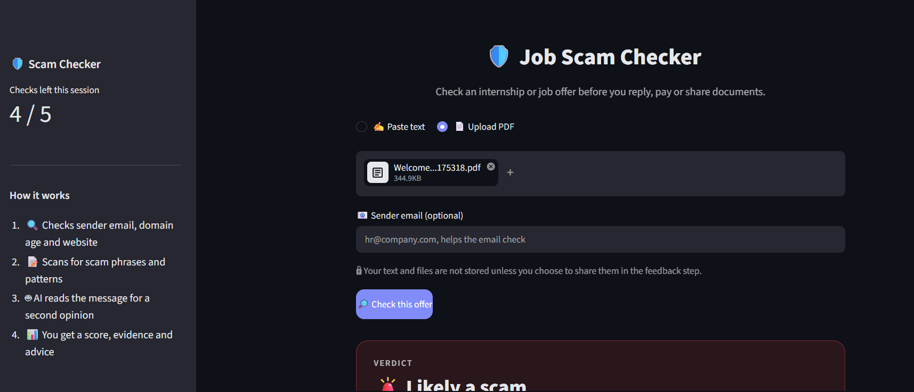
  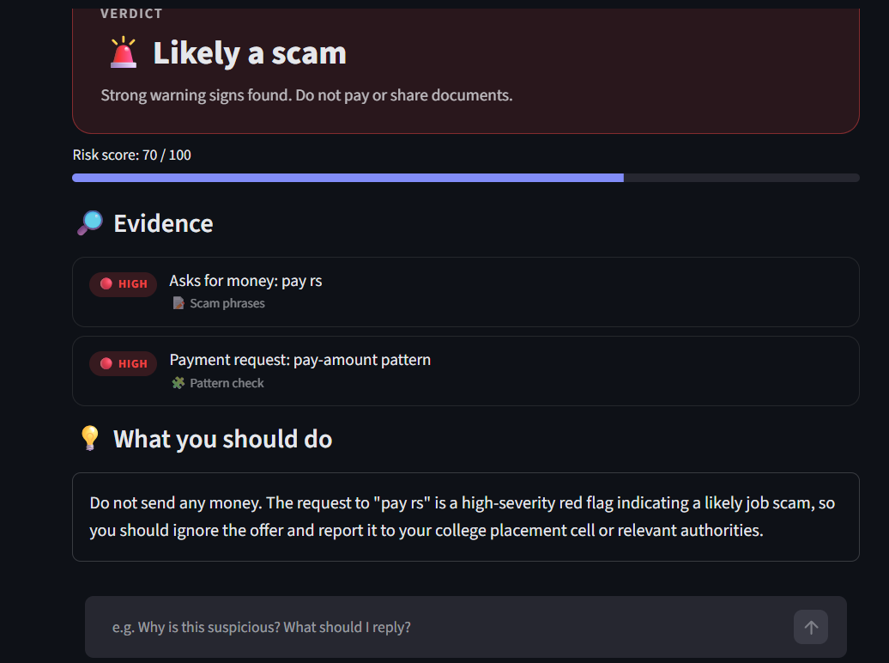
</p>

## Tech stack
Python · LangChain · Groq (`openai/gpt-oss-120b`, fallback `gpt-oss-20b`) · Pydantic · Streamlit · python-whois · BeautifulSoup · tldextract · pypdf · pytest · scikit-learn (experiments only) · Docker · AWS EC2 · Caddy (HTTPS reverse proxy, Let's Encrypt)

## Results

"Tuned on" means I changed rules or prompts after seeing that set's failures, so the number is optimistic. "Unseen" means nothing was tuned on it. Only the locked set was fully pre-registered.

| Set | Version | Result | Status |
|---|---|---|---|
| **Locked (42 real)** | **Hybrid, as deployed** | **15/21 scams caught, 0/21 false alarms (acc 85.7%)** | **unseen, pre-registered, headline** |
| Locked (42 real) | Logistic regression | 14/21 caught, 0/21 false alarms | comparison, no clear gain |
| Clean (14) | Hybrid | 5/7 caught, 1/7 false alarm (acc 78.6%) | unseen at the time |
| Final (16) | Rules only | recall 22.2%, FPR 0.0% | unseen |
| Final (16) | Hybrid, before fixes | recall 77.8%, FPR 42.9% | unseen |
| Final (16) | Hybrid, after fixes | recall 77.8%, FPR 0.0% | tuned on |
| Fresh 1 (10) | Rules, before tuning | acc 50.0%, recall 0.0% | unseen |
| Fresh 2 (10) | Rules only | acc 60.0%, recall 20.0% | unseen |
| Main (45) | Rules v1 (baseline) | acc 75.6%, recall 56.5% | baseline |
| Main (45) | Hybrid, final | acc 97.8%, recall 95.7% | tuned on |

With sets this small, one message moves accuracy by 2 to 10 points, so treat all numbers as indicative. Full table with confusion counts: [RESULTS.md](RESULTS.md).

### What each component contributes (final set of 16, unseen)

| Version | Recall | False positive rate |
|---|---|---|
| Rules only | 22.2% | 0.0% |
| Rules + LLM chains (before fixes) | 77.8% | 42.9% |

Rules never falsely accuse a company but miss polished scams. The LLM catches most of them but needed a carefully worded prompt to avoid flagging routine platform emails.

### Learned scoring experiment (development estimate)

I compared my hand-tuned weights with an L2-regularised logistic regression (C=1) using repeated stratified 5-fold cross-validation on 95 messages.

| Scorer | Accuracy | Recall | False positive rate |
|---|---|---|---|
| Hand-tuned rules (in-sample, optimistic) | 90.5% | 83.7% | 2.2% |
| Logistic regression | 85.5% | 73.9% | 2.2% |

The hand-tuned rules were written after seeing this data, so their figure is optimistic, and the confidence intervals overlap. On the locked set the learned model caught 14 of 21 scams versus 15-16 for the rules, again within noise. I found no clear gain from learning the weights, so I kept the transparent rules.

## What I learned
- Numbers on sets I tuned on (90%+) did not predict performance on unseen sets (50-79%), so I report the unseen ones and pre-registered a locked set.
- The LLM raised false positives on the main set (0% → 9.1%). I traced them to two weak signals, added a corroboration rule, and got back to 0%.
- A hand-written allowlist of recruiting platforms generalises only as far as the list does (Keka broke it).
- The same LLM can flip one result between runs, so small differences between runs are noise.

## Error analysis (locked set, 6 missed scams)

| Message | Why it was missed |
|---|---|
| Edvirra | Polished text on its own domain, no payment request |
| Workable / "PUMA" | Sent via a recruiting-platform domain that my allowlist treats as normal |
| fresherjobsz | Fake job-portal domain with a generic "hall ticket" lure |
| Tallymet | Polite interview invite pointing to WhatsApp |
| naukriapply | Impersonates a known brand, but no pattern fired |
| webboostsolutions | Free internship orientation with a stipend promise |

Common theme: polished scams with no fee request, sensitive-data ask or odd domain. I left these unfixed so the locked result stays valid.

## Input shielding and security tests

Untrusted text (messages and PDFs) is sanitised before analysis: hidden and zero-width characters are removed, Unicode lookalikes are normalised, and fake `<message>` tags are stripped. Prompts wrap the message in tags and tell the model it is untrusted data. A message that tries to instruct the checker is itself scored as a scam signal.

Rule-layer tests (no LLM calls) are in `test_security.py` (12 tests) and `security_demo.py`. The full suite (`test_rules.py`, `test_guardrails.py`, `test_security.py`) has 25 passing tests.

| Case | Layer that acts | Rules-only verdict |
|---|---|---|
| Plain prompt injection | Injection detector, scored as a scam signal | LIKELY_SCAM (100) |
| Zero-width obfuscated injection | Sanitiser removes hidden characters, then detector flags it | LIKELY_SCAM (80) |
| Fullwidth lookalike letters | Unicode normalisation, then detector flags it | LIKELY_SCAM (80) |
| Fake `</message>` delimiter break-out | Sanitiser strips the tag; payment and free-email rules score it | LIKELY_SCAM (90) |
| Injection hidden in PDF text | Extracted text reaches the detector, which flags it | LIKELY_SCAM (80) |
| Genuine message warning about fees | Negation handling | LIKELY_GENUINE (0) |
| Genuine message using "ignore" and "instructions" | Specific detector patterns, no flag | LIKELY_GENUINE (15) |
| Plain scam, no tricks | Phrase and pattern rules | LIKELY_SCAM (70) |

**Limits:** regex guardrails reduce crude attacks; paraphrased injections can slip past. The PDF case tests extracted text only. Hidden text by font colour is not detected, and no real malicious PDF was tested. The LLM layer is protected by design (delimited prompts; the LLM can only add points, never lower a rule score), which is not covered by an automated test.

## Dataset

137 messages in `data/`: **117 real** and **20 synthetic**.

- `test_set.csv` (45): 25 real plus 20 synthetic messages written in the style of real offers.
- `fresh_set.csv` (10), `fresh_set2.csv` (10), `final_set.csv` (16), `final_set2.csv` (14): all real.
- `locked_set.csv` (42): all real, collected and committed before testing.

Personal names, phone numbers and personal mailboxes were removed; company domains were kept because the tools check them. Company names are used only as realistic examples. The synthetic messages are fictional and do not come from the companies named.

## Limitations and future work

**Evaluation**
- The headline comes from 42 real messages, so one message moves accuracy by about 2.4 points and the recall interval is wide. Next step: collect more real messages, using the feedback buttons as a source.
- Rules and prompts were tuned on the earlier sets, so only the locked set is a fair estimate. Next step: keep a fresh locked set for any future change.

**Detection**
- Polished scams with no payment request, odd domain or sensitive-data ask are often missed. Next step: add sender-reputation data and compare against known scam reports.
- The recruiting-platform allowlist is hand-written, so legitimate senders outside it (such as Keka) can be flagged. Next step: a maintained list of platform sending domains.

**Data sources**
- WHOIS can fail or be blocked, and some large sites block bots. These are treated as "unknown", not suspicious.
- PDF upload supports text PDFs only (no OCR) and was tried on a few letters, not evaluated. Next step: OCR for scanned letters and screenshots.

**Scope**
- Advisory tool. It cannot confirm that an offer is genuine, so users should still verify the company on its official website.
- Single-instance demo deployment with a free subdomain; the usage log and feedback live on the server only.

## Run locally

```bash
git clone https://github.com/thisaditii/scam-checker.git
cd scam-checker
python -m venv venv
venv\Scripts\activate
pip install -r requirements.txt
```

Create a `.env` file:

```
GROQ_API_KEY=your_key_here
```

Then:

```bash
streamlit run app.py
pytest test_rules.py test_guardrails.py test_security.py
python evaluate.py data/test_set.csv
python evaluate_hybrid.py data/locked_set.csv
```

## Deployment

The app runs in Docker on an AWS EC2 instance (ap-southeast-2). Caddy sits in front as a reverse proxy and obtains a free Let's Encrypt certificate, so the public site is served over HTTPS. SSH is restricted to a single IP, and the API key lives only in a server-side `.env` file that is never committed or baked into the image.

```bash
docker build -t scam-checker .
docker run -d --name scam-checker -p 8501:8501 --env-file .env \
  -v ~/scam-data:/app/data/usage --restart unless-stopped scam-checker
```

## Project structure

```
app.py             Streamlit UI
pipeline.py        scoring and LangChain chains
tools.py           WHOIS (cached), email, phrase and pattern checks
guardrails.py      input sanitising and injection detection
schemas.py         Pydantic models
evaluate*.py       evaluation scripts
security_demo.py   security test demo table
experiments/       feature extraction and cross-validation experiment
test_*.py          unit and security tests
Dockerfile         container image for deployment
data/              test sets
ss/                screenshots
```